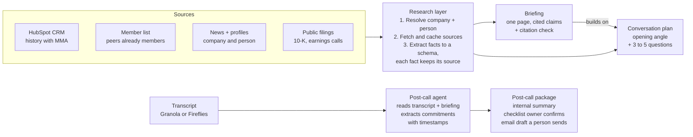
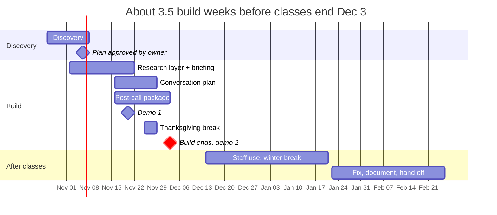

# MMA Meeting Assistant: Project Plan

Oct 25, 2026 · Ashwin Aggarwal

> **Note:** This is the original planning doc. Two decisions changed after it was written: the stack is now TypeScript (Next.js on Vercel, Vercel Workflow DevKit, AI SDK, Postgres + Drizzle) instead of Python/FastAPI, and the briefing and conversation plan are merged into one Meeting Doc with a prep view and an in-meeting view. See the scaffold prompt and ARCHITECTURE.md for the current design.

## Scope

V1 delivers three outputs for one prospect type, good enough that MMA's sales lead uses them for 10 real meetings. Everything else waits.

**In v1**

1. **Briefing** (one page, every claim sourced): the company in two sentences, its history with MMA, peer companies that are already members, recent news.
2. **Conversation plan**: an opening angle and 3 to 5 questions tailored to the person, informed by public filings.
3. **Post-call package**: internal summary, action checklist the meeting owner confirms, follow-up email draft a person edits and sends.

**Not in v1**: board connections, solution-provider briefings, writing reminders into the CRM or project tool, post-call news alerts, automatic follow-up checks, deck and proposal generation.

**Done when**: the sales lead rates briefings usable for 10 real prospect meetings, and follow-up drafts need only light edits.

**Constraints**

- Team of 3, about 5 to 8 hours a week each, roughly 15 to 24 team hours a week.
- MMA's proposed calendar: discovery weeks 1 to 2, build until Dec 3 with a demo every two weeks, staff use over winter break, handoff late February.
- Nothing is sent automatically. Every email and CRM change goes through a human in v1.

## Technical architecture

Build one shared research layer that turns sources into cited facts, then three thin generators on top. The "generic briefing" problem is solved by data, not prompting: MMA's own history and its member list are what a generic AI tool can't see.

The briefing and plan share the same fact store, so the plan can't contradict the briefing, and the post-call agent can check what was promised against what was known going in.

**Key design choices**

- **Facts before prose.** Extraction writes structured facts (claim, source URL or CRM record, date). The writer may only use facts from the store, and a check rejects any sentence without a source.
- **Cache by company.** Sources are fetched once per company and reused, which keeps cost down and makes eval runs repeatable.
- **Human in the loop everywhere.** Checklist items need owner confirmation; emails are drafts only.
- **Start with batch, not a UI.** V1 can generate briefings on request (a script or a simple form) and deliver them where the sales lead already reads. Build a UI only if discovery shows it's needed.

**Proposed stack** (confirm against MMA's preferences in discovery; superseded, see note at top)

| Layer | Choice | Note |
| --- | --- | --- |
| Language and API | Python, FastAPI | fits the team's background |
| Models | Claude or GPT via API | MMA gives access to frontier models; pick per task after evals |
| CRM | HubSpot API | read-only in v1 |
| Transcripts | Granola or Fireflies | confirm which one MMA uses and how exports work |
| Filings | SEC EDGAR | covers US public companies only |
| News | a news or search API | pick in week 2 |
| Storage | Postgres or SQLite | fact cache, outputs, eval logs |
| Delivery | email, Slack, or a doc | whatever the sales lead already uses |

## Discovery questions

The two answers that unblock everything: which prospect type v1 targets, and 3 to 5 example briefings or follow-ups the sales lead considers great. Get both in the first meeting.

**For the sales lead (the user)**

- [ ] Which prospect type should v1 cover (for example, US public consumer brands with a new CMO)?
- [ ] Walk us through how you prep for a meeting today. What takes longest, and what do you skip?
- [ ] What makes today's AI briefings feel generic? Show us one.
- [ ] Can you share 3 to 5 past meetings: your prep notes, the transcript, and the follow-up you actually sent?
- [ ] When and where do you want the briefing (night before, morning of; email, Slack, doc)?
- [ ] What do you typically promise on a call, and which follow-ups get dropped most?
- [ ] Who else on the sales team would use this, and do their meetings look the same?

**For Alec and MMA's AI team (systems and rules)**

- [ ] HubSpot: which objects and fields matter (deals, contacts, emails, meetings, membership tier)? Can we get read-only API access, or a sandbox?
- [ ] Is the member list in HubSpot or elsewhere? How do we tag industry and size to find peers?
- [ ] Granola or Fireflies: which one does sales use, and how do we get transcripts out (API, export, webhook)?
- [ ] Data rules: can CRM data and transcripts go to model APIs? Any GDPR or member-confidentiality limits on what we store?
- [ ] Where should the system run and where does code live (MMA's cloud, our repo, Vercel)?
- [ ] Which news and data sources does MMA already pay for?
- [ ] Does the CEO's spec have anything not on the project page? Who has final sign-off?

**For the team to decide after discovery**

- [ ] Final prospect type and the 10 test meetings
- [ ] Delivery channel
- [ ] Owner per pipeline (one person each for research layer, pre-call outputs, post-call)

## Week-by-week schedule

The research layer is the critical path: briefing and plan both depend on it, so it starts during discovery on sample data. Post-call runs in parallel because it only needs transcripts.

| Week | Focus | Exit check |
| --- | --- | --- |
| Oct 26 | Kickoff, access requests, collect past meetings | access requested; 3+ example meetings in hand |
| Nov 2 | Lock prospect type and eval targets; research layer on sample data | owner approves plan by Nov 6 |
| Nov 9 | Fact store + first cited briefing; transcript ingestion | one briefing reviewed by the sales lead |
| Nov 16 | Briefing on dev set; conversation plan; action-item extraction | eval script running |
| Nov 23 | Demo 1 (Nov 20 or the Monday after); Thanksgiving week, light load | demo feedback logged |
| Nov 30 | Email drafts, delivery channel, fix top failures | Demo 2 by Dec 3; first live meetings scheduled |
| Dec to Jan | Sales lead uses it on real meetings; we triage a short bug list remotely | live ratings collected |
| Late Jan to Feb | Fix, reach 10 rated meetings, document, hand off | done criteria met |

**Split for a team of 3:** one person owns the research layer and briefing, one owns the conversation plan and eval harness, one owns the post-call package and delivery. Everyone reviews outputs against real meetings.

## Eval plan

Turn "usable" and "light edits" into numbers the sales lead agrees to in week 2, then measure every build against them. Automated checks catch regressions; the sales lead's ratings decide done.

**Test set**

- **Dev set:** 10 to 15 past meetings from discovery (prep notes, transcript, sent follow-up). Used while building.
- **Live set:** the 10 real upcoming meetings that count toward done. Never tuned on.

**Briefing and plan**

| Check | How | Target (propose, then agree) |
| --- | --- | --- |
| Citation coverage | script: every sentence maps to a stored fact | 100% |
| Citation accuracy | LLM judge plus spot checks: the source supports the claim | 95%+ on a 50-claim sample |
| Factual errors | sales lead flags anything wrong | 0 material errors per briefing |
| MMA specificity | does it use CRM history and peer members, not just public info | present in every briefing |
| Usability | sales lead rates each briefing 1 to 5 before the call | 4+ on 10 live meetings |
| Question quality | sales lead marks which questions they would actually ask | 3+ of 5 used |

**Post-call package**

| Check | How | Target |
| --- | --- | --- |
| Commitment recall | compare extracted action items to a hand-labeled list per transcript | 90%+ |
| Commitment precision | items the owner rejects as not promised | under 10% |
| Edit distance | how much of the email draft changes before sending | light edits, for example under 20% of words |
| Edit log | save the draft and the sent version | review weekly for patterns |

**How we run it**

- An eval script runs the dev set on every meaningful change and logs scores, so we can compare prompt and model versions.
- One feedback form for the sales lead per meeting: rating, what was wrong, what was missing. Under one minute to fill out.
- Weekly review of failures; each failure becomes a test case.

## Risks and open questions

The biggest risk is the calendar: about 3.5 build weeks before Dec 3, with Thanksgiving and prelims inside them. Access delays are the second.

| Risk | Fallback |
| --- | --- |
| HubSpot or transcript access takes weeks | build against exported CSVs and sample transcripts; swap in the API later |
| Briefings still read as generic | lean harder on CRM history and peer members; ask the sales lead to mark generic lines and add them as negative examples |
| Hallucinated facts reach a CEO-level meeting | fact store plus citation check; sales lead reviews before every call in v1 |
| Prospect is private, so no filings | fall back to news, interviews, and the person's public talks; mark the plan as lower confidence |
| No business or sales teammate | ask MMA for a sales staff tester; one of us owns sales-lead feedback |
| Data rules block sending CRM data to model APIs | settle in week 1; use MMA's approved model accounts |
| Scope creep toward decks, proposals, CRM writes | point to the not-in-v1 list; log requests for phase 2 |

**Open questions for us**

- [ ] Has kickoff happened, and on what date? The schedule assumes the week of Oct 26.
- [ ] Can we see the CEO's full product spec? This plan is built from the project page and should be checked against it.
- [ ] Who on our team owns which pipeline?
